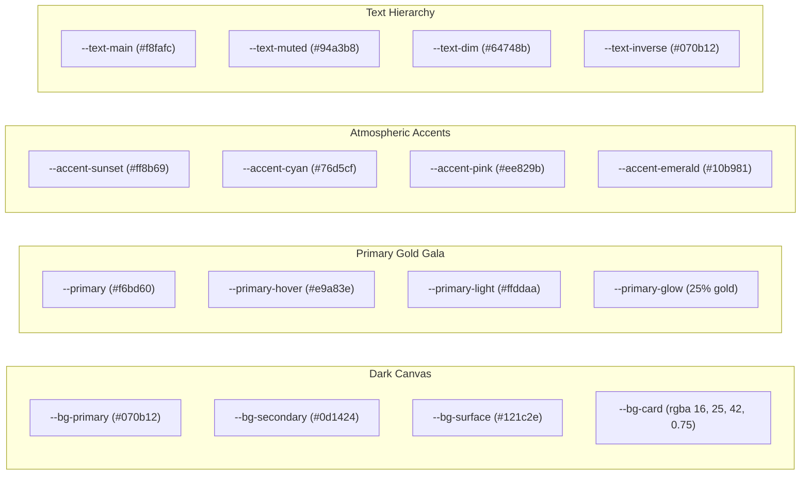

# TTV Club — GALA NIGHT 2026 Design System

**Project:** TTV Club GALA NIGHT Website  
**Role:** Senior UI/UX Designer and Frontend Engineer  
**Direction:** Cinematic Event Landing Page  
**Status:** Approved & Implemented (`npm run build` Passed with 0 Errors)

---

## 1. Design Vision & Visual Direction

The visual language of the GALA NIGHT 2026 website embodies a **Cinematic Event Experience** tailored for a dynamic student club celebrating a landmark milestone. It balances the youthful energy of creative media & technology with the prestige and elegance of an evening Gala concert.

### Core Visual Principles
1. **Atmospheric Obsidian Canvas:** Deep dark backgrounds (`#070b12` to `#0d1424`) with subtle cosmic radial gradients, creating an immersive stage-lighting mood without distracting content readability.
2. **Champagne Gold & Warm Sunset Accents:** High-converting warm gold (`#f6bd60`) and coral sunset (`#ff8b69`) gradients evoke festivity, honors, and celebration.
3. **Glassmorphism with Tactile Depth:** Layered frosted glass panels (`backdrop-filter: blur(18px)`) with crisp hairline borders (`rgba(255, 255, 255, 0.08)` to `rgba(246, 189, 96, 0.28)`) that elevate content from the dark background.
4. **Fluid Micro-Interactions:** Subtle lift effects (`translateY(-2px)` to `translateY(-3px)`), gold glow expansions on hover, and smooth spring-like transitions (`cubic-bezier(0.4, 0, 0.2, 1)`).
5. **Accessibility-First:** Keyboard-navigable `:focus-visible` rings with strong contrast, skip-to-content links, responsive typography, and `prefers-reduced-motion` compliance.

---

## 2. Color Palette & Lighting Tokens

All colors are exposed as CSS Custom Properties in `:root` inside `src/styles/index.css`:



### 2.1 CSS Variables Reference Table

| Category | Token | Value | Purpose |
| :--- | :--- | :--- | :--- |
| **Canvas** | `--bg-primary` | `#070b12` | Deep midnight obsidian base background |
| | `--bg-secondary` | `#0d1424` | Midnight navy container surface |
| | `--bg-card` | `rgba(16, 25, 42, 0.75)` | Frosted glass card fill |
| | `--bg-input` | `rgba(9, 15, 26, 0.85)` | High-contrast input background |
| **Gala Accent** | `--primary` | `#f6bd60` | Warm champagne gold for primary CTAs & badges |
| | `--primary-hover` | `#e9a83e` | Amber gold hover state |
| | `--primary-light` | `#ffddaa` | Soft sheen accent |
| | `--primary-glow` | `rgba(246, 189, 96, 0.25)` | Ambient lighting shadow glow |
| **Secondary Accents** | `--accent-sunset` | `#ff8b69` | Coral gradient end & highlight |
| | `--accent-cyan` | `#76d5cf` | Neon cyan for tech & time accents |
| | `--accent-emerald` | `#10b981` | Success confirmations & active badges |
| | `--error` | `#f43f5e` | Form validation error alerts |
| **Text** | `--text-main` | `#f8fafc` | High-contrast platinum white |
| | `--text-muted` | `#94a3b8` | Readable slate silver for paragraphs |
| | `--text-dim` | `#64748b` | Muted labels & timestamps |
| | `--text-inverse` | `#070b12` | Dark text for contrast on gold buttons |
| **Borders** | `--border-subtle` | `rgba(255, 255, 255, 0.08)` | Hairline dividers |
| | `--border-glass` | `rgba(255, 255, 255, 0.12)` | Glass card edges |
| | `--border-gold` | `rgba(246, 189, 96, 0.28)` | Brand highlight border |
| | `--border-focus` | `#f6bd60` | Accessible input focus ring |

---

## 3. Typography Hierarchy

The design system pairs two Google Fonts:
- **Heading Font:** `Outfit` (Geometric, punchy, modern sans-serif with bold personality).
- **Body Font:** `Plus Jakarta Sans` (Neutral, highly legible, optimized for digital screens).

### Scale & Fluid Rules

| Element | Font Family | Size Formula | Weight | Line Height |
| :--- | :--- | :--- | :--- | :--- |
| **Hero Title** | Outfit | `clamp(2.8rem, 6.5vw, 5.5rem)` | 800 | 1.08 |
| **Section Title** | Outfit | `clamp(2rem, 4.5vw, 3.25rem)` | 800 | 1.15 |
| **Card Title / H3** | Outfit | `clamp(1.2rem, 2.5vw, 1.45rem)` | 700 | 1.25 |
| **Subtitle / Lead** | Plus Jakarta Sans | `clamp(1.05rem, 2vw, 1.25rem)` | 400 | 1.75 |
| **Body Paragraph** | Plus Jakarta Sans | `0.92rem - 0.95rem` | 400 - 500 | 1.65 |
| **Kicker / Tag** | Plus Jakarta Sans | `0.8rem` | 700 (Uppercase) | 1.0 |
| **Helper / Caption** | Plus Jakarta Sans | `0.82rem` | 400 | 1.4 |

---

## 4. Component Design Specifications

### 4.1 Navbar (`src/components/common/Navbar.jsx`)
- **Positioning:** Sticky (`position: sticky; top: 0; z-index: 100;`).
- **Scroll-Aware Transparency:**
  - *Top State (`scrollY <= 25px` on `/`):* Semi-transparent (`rgba(7, 11, 18, 0.65)`), letting the ambient video hero shine through.
  - *Scrolled State (`scrollY > 25px` or on `/register`):* Adds `.navbar-scrolled` with deep blur (`backdrop-filter: blur(20px)`), frosted dark surface (`rgba(7, 11, 18, 0.93)`), gold border bottom, and shadow (`0 10px 35px rgba(0, 0, 0, 0.45)`).
- **Brand Link:** Club name + glowing gold icon + event badge `"GALA 2026"`.
- **Navigation Links:** Hover underline indicator with smooth width transition.
- **Primary CTA:** "Đăng Ký Tham Dự" button with gold gradient and ticket icon.
- **Mobile Menu:** Accessible hamburger button toggling an animated full-width glass drawer. Automatically closes when any link is clicked.

### 4.2 Footer (`src/components/common/Footer.jsx`)
- **Structure:** 3-column responsive grid (2fr - 1.2fr - 1fr) collapsing to 1 column on mobile.
  - *Column 1 (Identity & Social):* TTV Club name, full name, tagline, and direct buttons to Fanpage and Zalo Community.
  - *Column 2 (Event Organizer):* Official email, hotline, and venue address with gold Lucide icons.
  - *Column 3 (Navigation):* Quick links to Home, About Club, Gala Night, and Registration.
- **Bottom Bar:** Dynamic copyright year, club authority label, and a smooth "Lên đầu trang" (Scroll to Top) button.

### 4.3 Reusable Section Containers
- `.section`: Standard vertical padding (`clamp(4rem, 7vw, 6.5rem) 0`).
- `.section-alt`: Dark alternating background (`rgba(0, 0, 0, 0.25)`) with hairline top/bottom borders.
- `.section-header`: Centered layout container (`max-width: 740px; margin: 0 auto 3rem;`).
- `.section-tag`: Elegant pill kicker tag (`background: rgba(246, 189, 96, 0.1); border: 1px solid var(--border-gold); color: var(--primary)`).
- `.section-title`: Fluid heading with letter spacing `-0.03em`.
- `.section-desc`: Generous line-height (`1.7`) paragraph in slate silver.

### 4.4 Reusable Buttons
- `.btn-primary`: Champagne gold gradient (`linear-gradient(135deg, var(--primary) 0%, var(--primary-hover) 100%)`), dark text (`#070b12`), gold box-shadow. On hover: lifts 2px with enhanced glow.
- `.btn-secondary`: Glassmorphic button (`background: rgba(255, 255, 255, 0.05); border: 1px solid var(--border-glass)`). On hover: border switches to gold.
- `.btn-outline`: Transparent background with gold border and text.

### 4.5 Cards & Glassmorphism
- `.glass-card`: Base frosted glass card (`background: var(--bg-card); border: 1px solid var(--border-glass); backdrop-filter: blur(18px); border-radius: var(--radius-lg)`).
- `.glass-card-interactive`: Adds micro-interaction on hover (`transform: translateY(-3px); border-color: var(--border-gold); box-shadow: var(--shadow-lg), 0 0 30px var(--primary-glow)`).
- `.stat-card`: Center-aligned milestone card featuring fluid gradient stat figures (`stat-value`).

### 4.6 Media & Image Layouts
- `.media-frame`: Aspect-ratio wrapper with `overflow: hidden`, glass border, and dark background.
- `.aspect-16-9`, `.aspect-4-3`, `.aspect-1-1`: Standard media aspect ratio utilities.
- `.media-overlay`: Gradient overlay ensuring white text contrast over video/images.
- Micro-interaction: Smooth image zoom on frame hover (`transform: scale(1.03)`).

### 4.7 Responsive Grid Primitives
- `.grid-2`: 2 columns desktop, auto-stacking on mobile (`minmax(320px, 1fr)`).
- `.grid-3`: 3 columns desktop, auto-stacking on tablet/mobile (`minmax(280px, 1fr)`).
- `.grid-4`: 4 columns desktop (`minmax(220px, 1fr)`).

### 4.8 Form Controls (Preserved & Polished)
- `.form-control`: Dark slate input (`background: var(--bg-input)`) with gold focus glow (`box-shadow: 0 0 0 3px var(--primary-glow)`).
- `.choice-card`: Card-style radio/checkbox with gold border and glowing fill when `.selected`.
- `.single-checkbox-card`: Card checkbox with gold border for attendance confirmation.

---

## 5. Accessibility & Responsive Verification

1. **Focus States:** Every interactive control (`<a>`, `<button>`, `<input>`, `<textarea>`) features a high-contrast focus ring (`:focus-visible { outline: 2px solid var(--primary); outline-offset: 3px; }`).
2. **Skip Navigation:** The `.skip-link` allows keyboard users to bypass navigation directly to `#main-content`.
3. **Reduced Motion:** Full `@media (prefers-reduced-motion: reduce)` override disables transitions and sets `scroll-behavior: auto`.
4. **Mobile Responsiveness:**
   - Navbar collapses into mobile toggle and full drawer.
   - Hero title scales smoothly from `2.4rem` on 360px screens up to `5.5rem` on 4K displays.
   - Grids collapse to single columns on viewports $< 768px$.
   - Padding and margins scale with `clamp()` to avoid awkward horizontal scrolling or overflow.

---

## 6. Build Validation

```bash
> vite build

vite v5.4.21 building for production...
transforming...
✓ 1611 modules transformed.
rendering chunks...
computing gzip size...
dist/index.html                   1.15 kB │ gzip:  0.71 kB
dist/assets/index-BFyfOWv4.css   17.80 kB │ gzip:  4.50 kB
dist/assets/index-D5LI35-t.js   219.45 kB │ gzip: 70.78 kB
✓ built in 13.21s
```

**Status:** Completed with **0 errors and 0 warnings**.
