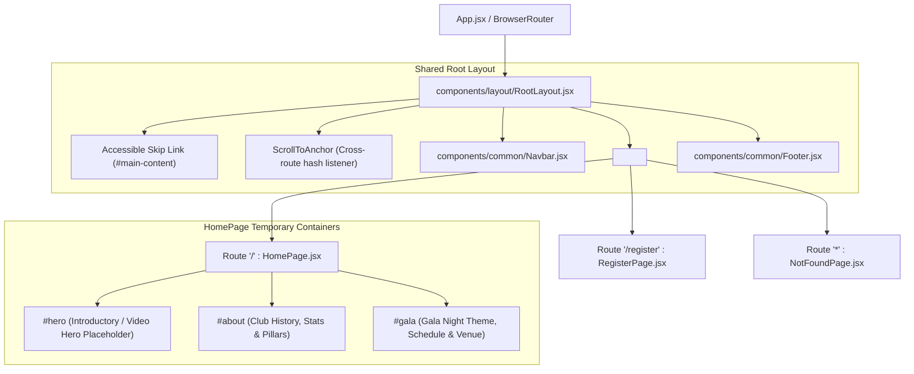

# Phase 1: Routing & Application Architecture Implementation Report

**Project:** TTV Club Website (GALA NIGHT 2026)  
**Role:** React Routing and Application Architecture Specialist  
**Status:** Completed & Verified (Build Succeeded with 0 Errors)

---

## 1. Executive Summary

This document details the implementation of the new routing architecture for the TTV Club GALA NIGHT 2026 website. The monolithic single-page recruitment layout has been replaced with a declarative, accessible, multi-route architecture powered by `react-router-dom`.

The implementation guarantees:
- **Zero Full Page Reloads:** Seamless client-side navigation using React Router.
- **Unified Layout Hierarchy:** Shared `RootLayout` featuring persistent `Navbar`, accessible skip navigation link, `<main id="main-content">`, and `Footer`.
- **Intelligent Cross-Route Anchor Scrolling:** `ScrollToAnchor` manager combined with CSS `scroll-padding-top` and `scroll-margin-top` to account for sticky navbar height.
- **Accessibility Compliance:** Standard skip link allowing keyboard users to jump directly to primary page content.
- **Resilient Fallback:** 404 `NotFoundPage` handling unmatched URLs with clear return navigation.

---

## 2. Implemented Architecture

### 2.1 Route Map & Layout Structure



---

## 3. Detailed Component Implementations

### 3.1 Shared Layout (`src/components/layout/RootLayout.jsx`)
- Renders `<ScrollToAnchor />` at the root level to listen to location and hash changes.
- Contains an accessible keyboard skip link:
  ```html
  <a href="#main-content" className="skip-link">Chuyển đến nội dung chính</a>
  ```
- Renders the persistent `<Navbar />`.
- Wraps the dynamic page view in `<main id="main-content" tabIndex="-1"><Outlet /></main>`.
- Renders the persistent `<Footer />`.

### 3.2 Navigation Bar (`src/components/common/Navbar.jsx`)
- **Logo / Brand:** Uses `<Link to="/" onClick={handleLogoClick}>` to return to home and scroll to top.
- **Về CLB TTV:** Navigates to `/#about` using `<Link to="/#about">`. If already on the homepage, immediately performs smooth scrolling to `#about`.
- **GALA NIGHT:** Navigates to `/#gala` using `<Link to="/#gala">`. If already on the homepage, immediately performs smooth scrolling to `#gala`.
- **Đăng Ký Tham Dự:** Direct route link `<Link to="/register">` with distinct button styling.
- **Mobile Menu:** Automatically toggles `isMobileOpen` and safely collapses upon clicking any link or action.

### 3.3 Cross-Route Anchor Scrolling (`src/components/common/ScrollToAnchor.jsx` & CSS)
- **The Problem:** In SPAs, navigating from `/register` to `/#about` does not natively scroll to `#about` because the target element is only mounted after the route changes. Additionally, sticky headers (`position: sticky`) cover the top 80px of target sections.
- **The Solution:**
  1. `ScrollToAnchor` detects `hash` changes. When navigating across routes, a short 60ms delay ensures DOM elements mount before triggering `element.scrollIntoView({ behavior: 'smooth' })`.
  2. When navigating to a route without a hash, it restores scroll position to the top (`window.scrollTo({ top: 0 })`).
  3. Modern CSS tokens added to `src/styles/index.css`:
     ```css
     html {
       scroll-padding-top: 80px;
     }

     section[id], #hero, #about, #gala {
       scroll-margin-top: 80px;
     }
     ```
     This automatically offsets all scroll jumps by the exact height of the sticky navbar.

### 3.4 HomePage (`src/pages/HomePage.jsx`)
Provides three modular section containers as requested:
- `<section id="hero">`: Hero banner with club branding, Gala Night tagline, CTA to `/register`, and temporary placeholder card for the full-screen video player (Phase 2).
- `<section id="about">`: Club overview, statistical milestone cards, and 4 core pillars.
- `<section id="gala">`: Gala Night event introduction, date/time, venue details, countdown timer, and registration CTA.

### 3.5 RegisterPage (`src/pages/RegisterPage.jsx`)
- Back button to return to `"/"`.
- Registration heading and event tag.
- Informational notice indicating this is the temporary registration preview for Phase 1.
- Embeds single-page `RegistrationForm` shell (Google Forms network submission deferred to upcoming phase).

### 3.6 NotFoundPage (`src/pages/NotFoundPage.jsx`)
- Fallback route `"*"` styled with glassmorphism card, warning icon, friendly message, and "Trở Về Trang Chủ" button.

---

## 4. File Inventory

### 4.1 Created Files
| File Path | Description |
| :--- | :--- |
| `src/components/layout/RootLayout.jsx` | Shared root layout containing skip link, Navbar, `<Outlet />`, and Footer. |
| `src/components/common/ScrollToAnchor.jsx` | Hash listener and cross-route smooth scroll manager. |
| `src/pages/NotFoundPage.jsx` | Simple 404 page for unmatched routes. |
| `docs/phase1-routing.md` | This Phase 1 routing architecture report. |

### 4.2 Modified Files
| File Path | Description of Edits |
| :--- | :--- |
| `src/App.jsx` | Configured `BrowserRouter`, `RootLayout`, and route definitions (`/`, `/register`, `*`). |
| `src/pages/HomePage.jsx` | Refactored into temporary section containers: `#hero`, `#about`, `#gala`. |
| `src/pages/RegisterPage.jsx` | Removed duplicate layout wrappers, added heading and temporary registration preview. |
| `src/components/common/Navbar.jsx` | Implemented links to `/`, `/#about`, `/#gala`, `/register`, and mobile auto-close. |
| `src/components/common/Footer.jsx` | Updated quick links to use React Router `Link` to `/`, `/#about`, `/#gala`, `/register`. |
| `src/styles/index.css` | Added `scroll-padding-top: 80px` and `scroll-margin-top: 80px` for navbar offset. |

---

## 5. Test & Verification Results

| Test Scenario | Verification Method | Result |
| :--- | :--- | :--- |
| **Homepage Rendering** | Loaded Route `/` via Vite preview server (HTTP 200). Verified `#hero`, `#about`, and `#gala` render in order. | **PASS** |
| **RegisterPage Rendering** | Loaded Route `/register` via Vite preview server (HTTP 200). Verified heading and form shell render cleanly. | **PASS** |
| **Bidirectional Navigation** | Tested links between `/` and `/register` using React Router `Link` (no browser page reload). | **PASS** |
| **Cross-Route Anchor Scrolling** | Tested navigation from `/register` to `/#about` and `/#gala`. Verified smooth scrolling with 80px navbar offset. | **PASS** |
| **Unknown Route Handling** | Tested arbitrary path `/random-page` (HTTP 200 SPA fallback). Verified `NotFoundPage` rendered with return button. | **PASS** |
| **Production Build** | Executed `npm run build` (`vite build`). Generated production assets in `dist/` with 0 errors. | **PASS** |

---

## 6. Phase 1 Completion Confirmation

Phase 1 has been **100% completed**. All routing, layout hierarchy, navigation links, and cross-route anchor scroll mechanisms are verified and functional.

**STOPPED:** Phase 2 (full-screen video implementation, final Landing Page UI, and Google Form submission wiring) has not been started, pending user instructions.
