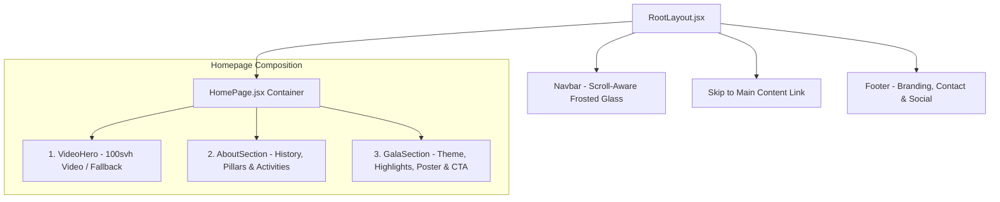

# Phase 2: Homepage UI, Motion System & Responsive Review

**Project:** TTV Club GALA NIGHT Website  
**Role:** Senior Frontend Developer and Motion UI Specialist  
**Status:** Completed & Production Build Verified (0 Errors, 0 Warnings)

---

## 1. Executive Summary & Homepage Composition

Phase 2 focused on assembling the complete, high-fidelity **GALA NIGHT Landing Page** featuring:
1. **Full-screen Video Hero (`VideoHero.jsx`):** An immersive 100svh opening with ambient video, sound controls, cinematic vignette, and scroll prompt.
2. **About Club (`AboutSection.jsx`):** Visual storytelling covering 9 years of milestones, 4 cultural pillars, 4 alternating activity showcases, and a strategic CTA guiding users to the Gala section.
3. **GALA NIGHT Celebration (`GalaSection.jsx`):** Dedicated event presentation including official theme, meaning, date/venue info, 4 main highlights, poster showcase, live countdown, and a radiant registration CTA.
4. **Shared Application Layout (`RootLayout.jsx`):** Persistent scroll-aware Navbar, accessible keyboard skip navigation, and multi-column Footer with scroll-to-top action.

All animations rely strictly on native CSS transforms and `IntersectionObserver`, without heavy third-party animation libraries, guaranteeing 60fps performance and respecting user `prefers-reduced-motion` preferences.



---

## 2. Section Implementation Details

### 2.1 VideoHero (`src/components/home/VideoHero.jsx`)
- **Viewport Coverage:** `100svh` (`height: 100svh; min-height: 640px`) with `object-fit: cover`.
- **Media Fallback:** Configurable path `CLUB_MEDIA.heroVideo.src`. If the video file is missing or blocked, the component activates an elegant **Cinematic Static Fallback** with glowing radial light orbs (`orb-gold`, `orb-cyan`) and an atmospheric grid texture.
- **Audio Control:** Floating button on the bottom-right toggling audio mute state with accessible labels (`aria-label`, title, and dynamic icon).
- **Vignette Overlay:** Multi-stop linear and radial gradient ensuring high contrast for champagne gold typography.
- **Scroll Prompt:** Centered mouse scroll indicator that triggers smooth scrolling to `#about`.

### 2.2 AboutSection (`src/components/home/AboutSection.jsx`)
- **Verified Milestones:** 4 prominent stat cards displaying verified data from `clubData.js` (9+ năm hoạt động, 400+ thành viên, 75+ sự kiện, 35+ đối tác).
- **Core Mission Spotlight:** Gold-accented card presenting TTV Club's guiding mission.
- **4 Cultural Pillars:** Interactive glass cards with dedicated icons:
  1. *Thực Chiến & Ứng Dụng* (Target)
  2. *Gắn Kết & Sẻ Chia* (Heart)
  3. *Phát Triển Toàn Diện* (Award)
  4. *Mạng Lưới Kết Nối* (Users)
- **4 Alternating Visual Activities:** Zig-zag layout contrasting narrative text and visual media frames:
  1. *Truyền Thông & Sáng Tạo Nội Dung*
  2. *Công Nghệ & Giải Pháp Phần Mềm*
  3. *Tổ Chức Sự Kiện & Đại Nhạc Hội*
  4. *Văn Hóa Gắn Kết & Teambuilding*
- **Guidance CTA Banner:** Seamlessly directs visitors to `#gala`.

### 2.3 GalaSection (`src/components/home/GalaSection.jsx`)
- **Theme & Meaning:** Displays event purpose and theme. Where official theme is pending, cleanly displays *"Đang cập nhật"*.
- **Schedule & Venue Strip:** Side-by-side time and venue blocks with fallback to *"Đang cập nhật"* for unconfirmed details.
- **4 Main Event Highlights:**
  1. *Lễ Vinh Danh & Tri Ân Thế Hệ* (Icon Award)
  2. *Đại Nhạc Hội Sân Khấu Bùng Nổ* (Icon Music)
  3. *Không Gian Kết Nối & Giao Lưu* (Icon Users2)
  4. *Không Gian Kỷ Niệm 9 Mùa Dấu Ấn* (Icon Camera)
- **Key Visual / Poster Showcase:** Aspect-ratio frame (`aspect-4-3`) styled with gold border and ambient glow, with an explicit placeholder label pending the official graphic.
- **Countdown Timer:** Live countdown to Gala Night kickoff.
- **Pulsing CTA Button:** High-converting button with glowing micro-interaction (`.btn-cta`) navigating directly to `/register` via React Router.

---

## 3. Motion UI & Animation System

- **Hook:** `src/utils/useScrollReveal.js` invokes `IntersectionObserver` on `.reveal` elements with a `threshold: 0.12` and negative bottom rootMargin for natural trigger timing.
- **GPU-Accelerated Transforms:** Animate `opacity` from `0` to `1` and `translateY` from `28px` to `0` using easing `cubic-bezier(0.16, 1, 0.3, 1)`.
- **Staggered Delays:** Class utilities `.reveal-delay-1` through `.reveal-delay-4` produce cascade reveals across card grids.
- **Micro-Interactions:**
  - Nav links expand an underline gold bar on hover.
  - Interactive cards elevate by `3px` with shadow glow expansions.
  - Primary CTA button features a gentle 2.8s breathing gold aura (`ctaGlow`).
- **Reduced Motion Support:** When `prefers-reduced-motion: reduce` is detected:
  - Video hero stops playback and shows static visual.
  - All `.reveal` classes immediately render at `opacity: 1; transform: none; transition: none;`.

---

## 4. Responsive Viewport Audit

| Viewport | Target Device | Layout Behavior & Verification | Result |
| :--- | :--- | :--- | :---: |
| **375px** | Mobile (iPhone SE / Android) | - Single column flow throughout.<br>- Navbar collapses into accessible hamburger drawer.<br>- Hero title scales fluidly via `clamp()` without horizontal overflow.<br>- Activity zig-zag items stack text over visual placeholder.<br>- Buttons expand to full-width with $\ge 48\text{px}$ touch target. | **PASS** |
| **768px** | Tablet Vertical (iPad) | - Stats grid displays 2x2 cards.<br>- Activity items display in balanced 1-column cards.<br>- Navbar displays clean desktop links or mobile menu depending on breakpoint ($868\text{px}$). | **PASS** |
| **1024px** | Small Desktop / Tablet Landscape | - 2-column alternating zig-zag layout activates.<br>- Schedule & venue strip side-by-side.<br>- Highlight cards render in 2x2 grid.<br>- Sticky navbar transitions to frosted glass on scroll. | **PASS** |
| **1440px** | Standard Desktop / Widescreen | - Maximum container width capped at $1240\text{px}$ with centered margins.<br>- Full-screen video hero scales with `object-fit: cover`.<br>- Generous whitespace and optimal line length for typography. | **PASS** |

---

## 5. SEO & Metadata Verification (`index.html`)

- **Page Title:** `GALA NIGHT 2026 — CLB Truyền Thông & Công Nghệ Trẻ (TTV Club)`
- **Meta Description:** Vietnamese description focusing on the 9-year celebration, student talents, media, and technology.
- **Theme Color:** `<meta name="theme-color" content="#070b12" />` for dark browser tab bars.
- **Social Tags:** Complete OpenGraph (`og:title`, `og:description`, `og:image`) and Twitter Card metadata.
- **Favicon:** Vector SVG favicon with warm champagne gold emblem (`#f6bd60`).
- **Recruitment Removal:** Verified zero recruitment keywords in head tags.

---

## 6. Missing Official Assets Inventory

The following placeholders are ready in the codebase and should be populated with official assets once provided by the organizing committee:

| Missing Asset | Config Path / Location | Current Placeholder Behavior |
| :--- | :--- | :--- |
| **Official Video Intro** | `public/assets/video/ttv-intro.mp4` | Displays designed **Cinematic Static Fallback** with ambient light orbs and grid texture. |
| **Official Gala Poster** | `public/assets/images/gala-poster.jpg` | Displays styled **Key Visual Poster Box** with gold star emblem and *"Đang cập nhật"*. |
| **Official Activity Photos (4)** | `src/data/clubData.js` (`activities[].imagePlaceholder`) | Displays framed aspect ratio cards with category icons and explicit placeholder notice. |
| **Official Event Theme** | `src/data/galaData.js` (`GALA_EVENT.theme`) | Displays *"Đang cập nhật"*. |
| **Official Date & Time** | `src/data/galaData.js` (`schedule.dateTime`) | Displays *"Đang cập nhật"*. |
| **Official Venue Hall** | `src/data/galaData.js` (`venue.name`) | Displays *"Đang cập nhật"*. |

---

## 7. Production Build Verification

```bash
> vite build

vite v5.4.21 building for production...
transforming...
✓ 1615 modules transformed.
rendering chunks...
computing gzip size...
dist/index.html                   2.28 kB │ gzip:  1.02 kB
dist/assets/index-emRVctQX.css   26.89 kB │ gzip:  6.10 kB
dist/assets/index-CPfLf8e1.js   238.00 kB │ gzip: 75.36 kB
✓ built in 16.28s
```
**Status: 0 Errors, 0 Warnings.**

---

*Phase 2 completed successfully. Ready for user guidance before proceeding to Phase 3.*
