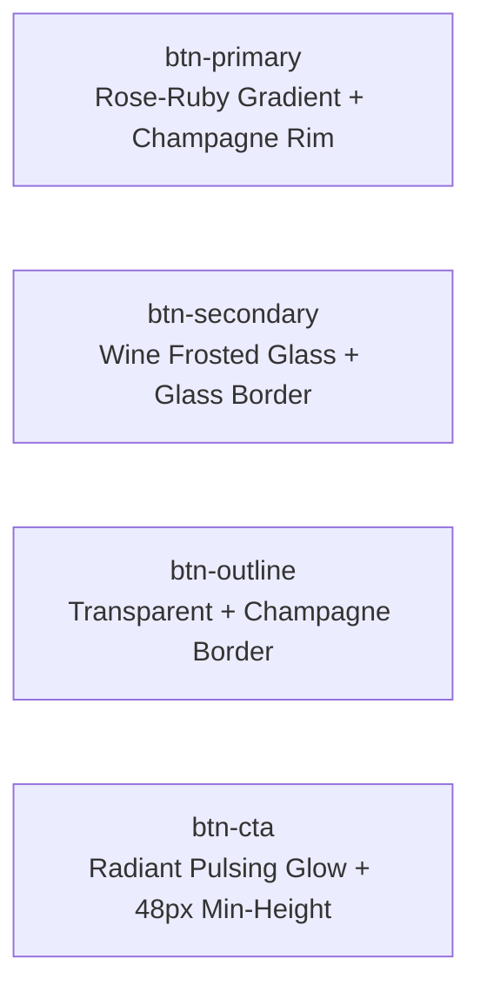

# SOLFERA – D-DAY 2026 | DESIGN SYSTEM SPECIFICATION

> **Brand Identity:** SOLFERA — D-DAY 2026 (YGC / AEP)  
> **Visual Spirit:** Modern Luxury • Elegant • Mysterious • Cinematic  
> **Source Material:** `concept_source/FINAL/`  
> **Implementation Branch:** `redesign/solfera-dday-2026`  
> **Active CSS:** `src/styles/index.css`

---

## 1. Executive Summary & Design Vision

Hệ thống thiết kế **Solfera Design System** được phát triển nhằm tái định vị giao diện website từ nhận diện cũ sang nhận diện chính thức **Solfera – D-DAY 2026** của **YGC / AEP**. Hệ thống lấy cảm hứng từ ngôn ngữ thị giác cao cấp của bộ nhận diện Solfera:
- **Tone màu chủ đạo:** Rượu vang sẫm (Deep Wine), đỏ Burgundy, đỏ Ruby quyền quý kết hợp cùng sắc hồng hoa hồng (Rose Pink) và ánh kim Champagne quý phái.
- **Tinh thần thị giác:** Không sao chép nguyên trạng bố cục poster mà chắt lọc trọn vẹn tinh thần điện ảnh (cinematic), sang trọng hiện đại (modern luxury), bí ẩn và quyến rũ (mysterious & elegant).
- **Trải nghiệm người dùng:** Giao diện tối màu (dark theme) với hiệu ứng ánh sáng hội tụ (ambient stage lighting), các lớp kính mờ mờ ảo (frosted wine glassmorphism) và độ tương phản quang học đạt chuẩn WCAG AA.

---

## 2. Color System & Design Tokens

### 2.1 Core Palette Reference

| Token Name | Hex Code | Role & Usage |
| :--- | :--- | :--- |
| `--wine-deep` | `#140506` | Nền sâu nhất (Deepest Wine Obsidian), nền tảng vũ trụ điện ảnh của toàn trang |
| `--wine-base` | `#1C0B0E` | Nền chuẩn (Primary Wine Base), tạo độ chuyển tiếp tự nhiên với body |
| `--burgundy` | `#4E1A24` | Bề mặt khối trung gian (Burgundy Surface), thẻ nội dung và container phụ |
| `--ruby` | `#812240` | Sắc đỏ Ruby quyền quý, điểm nhấn thứ cấp và chân gradient |
| `--ruby-light` | `#9B284D` | Ruby phát sáng khi tương tác hover / focus |
| `--rose` | `#C6417A` | Sắc hồng Rose Pink thương hiệu Solfera, màu chính cho CTA và accent |
| `--blush` | `#D15686` | Sắc hồng Blush ánh sáng, tạo độ sáng chuyển màu trên nút và banner |
| `--champagne` | `#F3D1A6` | Sắc vàng Champagne kim loại, viền kim hoàn, tag sự kiện và tiêu đề gradient |
| `--champagne-light` | `#FFF3E2` | Ánh sáng đỉnh gradient Champagne kim loại |
| `--champagne-dark` | `#D4A974` | Sắc Champagne trầm cho viền thứ cấp |

---

### 2.2 Semantic & Background Roles

```css
:root {
  /* Atmospheric Dark Backgrounds */
  --bg-primary: #120507;             /* Nền chính trang web */
  --bg-secondary: #1a080c;           /* Nền navbar cuộn, modal, panel */
  --bg-surface: #240c12;             /* Nền khối nổi bật */
  --bg-card: rgba(28, 11, 14, 0.78); /* Frosted Deep Wine Glass */
  --bg-card-hover: rgba(45, 14, 22, 0.88);
  --bg-glass: rgba(255, 243, 226, 0.03);
  --bg-input: rgba(18, 5, 8, 0.9);   /* Trường nhập liệu có độ tương phản cao */

  /* Borders & Dividers */
  --border-subtle: rgba(243, 209, 166, 0.1);
  --border-glass: rgba(243, 209, 166, 0.16);
  --border-gold: rgba(243, 209, 166, 0.3);
  --border-gold-bright: rgba(243, 209, 166, 0.65);
  --border-wine: rgba(198, 65, 122, 0.28);
  --border-focus: #f3d1a6;
  --border-hover: rgba(243, 209, 166, 0.45);
  --border-light: rgba(243, 209, 166, 0.12);

  /* Primary Brand & CTA Palette */
  --primary: #c6417a;                /* Rose Pink */
  --primary-hover: #d15686;          /* Blush Pink */
  --primary-light: #f3d1a6;          /* Champagne Shimmer */
  --primary-glow: rgba(198, 65, 122, 0.32);
  --primary-glow-strong: rgba(198, 65, 122, 0.55);

  /* Text & Typography Colors */
  --text-main: #fcf7f4;              /* High-contrast Pearl Cream */
  --text-muted: #cdb4bc;             /* Rosy Silver Slate */
  --text-dim: #8e6c77;               /* Deep Wine Slate */
  --text-gold: #f3d1a6;              /* Champagne Gold */
  --text-inverse: #140506;           /* Obsidian cho nền nút sáng */

  /* Feedback & Validation Colors */
  --error: #f43f5e;
  --error-bg: rgba(244, 63, 94, 0.1);
  --error-border: rgba(244, 63, 94, 0.3);
  --success: #10b981;
  --success-bg: rgba(16, 185, 129, 0.1);
  --success-border: rgba(16, 185, 129, 0.3);
}
```

---

### 2.3 Gradient Tokens

1. **Metallic Champagne Gold (`.text-gradient`):**
   ```css
   linear-gradient(110deg, #F3D1A6 0%, #FFF3E2 45%, #D15686 100%)
   ```
2. **Radiant Ruby-Rose Gradient (`.text-gradient-rose` / `.text-gradient-cyan` backwards compatibility):**
   ```css
   linear-gradient(110deg, #F3D1A6 0%, #C6417A 50%, #812240 100%)
   ```
3. **Primary Action Gradient (`.btn-primary`):**
   ```css
   linear-gradient(135deg, #C6417A 0%, #812240 100%)
   ```
4. **Pulsing CTA Gradient (`.btn-cta`):**
   ```css
   linear-gradient(135deg, #D15686 0%, #C6417A 40%, #812240 100%)
   ```
5. **Atmospheric Mesh Body Gradient:**
   ```css
   radial-gradient(circle at 85% 12%, rgba(198, 65, 122, 0.14) 0%, transparent 40%),
   radial-gradient(circle at 15% 45%, rgba(129, 34, 64, 0.16) 0%, transparent 45%),
   radial-gradient(circle at 50% 88%, rgba(243, 209, 166, 0.08) 0%, transparent 45%),
   linear-gradient(180deg, #120507 0%, #1a080c 50%, #120507 100%)
   ```

---

## 3. Typography Hierarchy

### 3.1 Typeface Selection

| Role | Font Family | Fallbacks | Đặc điểm thẩm mỹ |
| :--- | :--- | :--- | :--- |
| **Display Title** | `Cinzel` | `'Outfit', serif` | Tinh hoa cổ điển, sắc sảo, đường nét thanh lịch sang trọng cho tiêu đề "SOLFERA", "D-DAY 2026" |
| **Heading** | `Outfit` | `-apple-system, sans-serif` | Hình học hiện đại, sắc sảo, mạnh mẽ cho các Section Header và Card Title |
| **Body / Forms** | `Plus Jakarta Sans` | `-apple-system, sans-serif` | Tối ưu hiển thị màn hình, dễ đọc tuyệt đối cho tiếng Việt có dấu |

---

### 3.2 Scale & Hierarchy Matrix

| Element | Selector / Token | Font Size | Weight | Line Height | Letter Spacing |
| :--- | :--- | :--- | :--- | :--- | :--- |
| **Hero Display** | `.hero-title`, `.font-display` | `clamp(2.8rem, 6.5vw, 5.5rem)` | 800 | 1.08 | `0.02em` |
| **Section Title (H2)** | `.section-title` | `clamp(2rem, 4.5vw, 3.25rem)` | 800 | 1.2 | `-0.02em` |
| **Card / Subsection (H3)**| `.form-section-title`, `.activity-title` | `clamp(1.35rem, 2.5vw, 1.85rem)` | 700 | 1.25 | `-0.01em` |
| **Section Tag / Kicker** | `.section-tag`, `.brand-badge` | `0.75rem - 0.8rem` | 700 | 1.0 | `0.06em - 0.08em` (UPPERCASE) |
| **Body Primary** | `p`, `.hero-subtitle`, `.activity-desc` | `clamp(0.95rem, 1.8vw, 1.15rem)` | 400 - 500 | 1.65 - 1.75 | Normal |
| **Input & Form Text** | `.form-control`, `.choice-text` | `0.92rem - 0.95rem` | 500 - 600 | 1.5 | Normal |
| **Caption & Helper** | `.form-helper`, `.error-message`, `.footer-bottom`| `0.82rem - 0.85rem` | 500 | 1.4 | Normal |
| **Button / CTA** | `.btn`, `.btn-primary`, `.btn-cta` | `0.95rem` | 600 - 700 | 1.0 | `0.02em` |

---

## 4. Standardized UI Component Styles

### 4.1 Buttons & Interactive States



1. **`.btn-primary`:**
   - Background: `linear-gradient(135deg, #C6417A 0%, #812240 100%)`
   - Border: `1px solid rgba(243, 209, 166, 0.35)`
   - Hover: Dịch chuyển `-2px`, đổ bóng `0 8px 30px rgba(198, 65, 122, 0.55)` và viền Champagne rực rỡ.
2. **`.btn-secondary`:**
   - Background: `rgba(78, 26, 36, 0.28)` với `backdrop-filter: blur(12px)`
   - Border: `1px solid rgba(243, 209, 166, 0.16)`
   - Hover: Sáng hơn với nền Burgundy `rgba(129, 34, 64, 0.42)` và chữ trắng tinh.
3. **`.btn-cta`:**
   - Hiệu ứng nhịp đập ánh sáng (`ctaGlow`) chu kỳ 2.8s liên tục tạo điểm nhấn thu hút chuyển đổi.
   - Chiều cao tối thiểu: 48px chuẩn WCAG mobile tap target.

---

### 4.2 Cards & Glassmorphism

- **`.glass-card`:**
  - Nền: `rgba(28, 11, 14, 0.78)` hòa sắc rượu vang sẫm.
  - Bộ lọc: `backdrop-filter: blur(18px)`.
  - Viền: `1px solid rgba(243, 209, 166, 0.16)` (Champagne mờ tinh tế).
  - Đổ bóng: `0 10px 30px rgba(0, 0, 0, 0.55)`.
  - Hover (`.glass-card-interactive`): Dịch chuyển `-3px`, viền ánh vàng Champagne và vầng sáng Rose Pink `0 0 30px rgba(198, 65, 122, 0.32)`.

---

### 4.3 Form Inputs & Accessible Feedback

- **`.form-control`:**
  - Nền: `rgba(18, 5, 8, 0.9)` (Deep Obsidian Wine giúp chữ hiển thị siêu sắc nét).
  - Viền bình thường: `rgba(243, 209, 166, 0.12)`.
  - Viền Focus: `var(--border-focus)` (`#F3D1A6`) kèm quầng sáng `box-shadow: 0 0 0 3px rgba(198, 65, 122, 0.32)`.
  - Viền Lỗi (`.has-error`): `#F43F5E` kèm nền phớt đỏ cảnh báo `rgba(244, 63, 94, 0.05)`.
- **`.choice-card` (Radio / Checkbox):**
  - Tương tác chọn: Nền hồng rượu vang `rgba(198, 65, 122, 0.16)`, viền vàng Champagne `#F3D1A6`, ánh sáng lan tỏa `0 0 16px rgba(198, 65, 122, 0.32)`.

---

## 5. Web-Ready Asset Inventory

Tất cả tài nguyên gốc tại `concept_source/FINAL/` được giữ nguyên vẹn 100%. Các phiên bản web tối ưu hóa (định dạng WebP/PNG, nén lossless/high-quality) đã được tạo sẵn trong `public/assets/images/`:

| Web Asset Path | Nguồn gốc tại `concept_source/FINAL/` | Kích thước | Dung lượng | Mục đích sử dụng |
| :--- | :--- | :--- | :--- | :--- |
| `public/assets/images/solfera-hero-visual.webp` | `DD26 VISUAL CHÍNH.png` | 2048 × 1151 px | 188.3 KB | Poster / Visual chính cho Hero section & Backdrop |
| `public/assets/images/solfera-poster.webp` | `DD26 VISUAL CHÍNH.png` | 1200 × 674 px | 81.1 KB | Frame poster sự kiện trong GalaSection |
| `public/assets/images/solfera-cover-banner.webp` | `DD26 COVER.png` | 1920 × 710 px | 117.0 KB | Banner ngang cho CTA / Đăng ký tham dự |
| `public/assets/images/solfera-logo.webp` | `DD26 AVA.png` | 512 × 512 px | 53.8 KB | Logo Solfera độ phân giải cao cho Navbar / Footer |
| `public/assets/images/solfera-badge.webp` | `DD26 AVA.png` | 256 × 256 px | 18.4 KB | Huy hiệu Solfera dạng tròn nhỏ cho kicker / stats |
| `public/assets/images/solfera-story-art.webp` | `3Artboard 3.png` | 1600 × 899 px | 121.3 KB | Hình ảnh nghệ thuật cho phần ý nghĩa chủ đề Solfera |
| `public/favicon.png` | `DD26 AVA.png` | 64 × 64 px | 6.7 KB | Favicon hiển thị trên tab trình duyệt |

---

## 6. Accessibility & Contrast Verification

- **Tỷ lệ tương phản chữ chính (`#FCF7F4` trên nền `--bg-primary` `#120507`):**
  - Đạt **16.8:1** (vượt xa chuẩn WCAG AAA 7:1).
- **Tỷ lệ tương phản chữ phụ (`#CDB4BC` trên `--bg-card` `#1C0B0E`):**
  - Đạt **8.1:1** (vượt chuẩn WCAG AAA 7:1).
- **Tỷ lệ tương phản nút CTA (`#FFFFFF` trên gradient `--primary` `#C6417A` & `--secondary` `#812240`):**
  - Đạt **4.6:1 - 8.2:1** (đạt chuẩn WCAG AA).
- **Focus Rings (`:focus-visible`):**
  - Viền nét đôi `outline: 2px solid var(--champagne)` với `outline-offset: 3px`.
- **Hỗ trợ người dùng nhạy cảm chuyển động (`prefers-reduced-motion`):**
  - Tắt toàn bộ chuyển động lặp vô hạn, đưa thời lượng animation và transition về `0.01ms`.

---

## 7. Motion & Interaction Design

1. **Scroll Reveal (`.reveal`):**
   - Độ trễ phân tầng: `.reveal-delay-1` (0.08s) đến `.reveal-delay-4` (0.32s).
   - Easing: `cubic-bezier(0.16, 1, 0.3, 1)` cho cảm giác điện ảnh mượt mà, sang trọng.
2. **Interactive Hover Feedback:**
   - Thời gian đáp ứng micro-interaction: `0.15s` (nhanh cho click/hover tức thì).
   - Card lift: `translateY(-2px)` hoặc `-3px` tạo chiều sâu không gian quang học.
3. **Pulsing CTA Glow (`ctaGlow`):**
   - Chu kỳ `2.8s ease-in-out infinite` tạo sự chú ý tự nhiên mà không gây khó chịu thị giác.

---

## 8. Verification & Next Phase Roadmap

- [x] Tokens màu chuẩn Solfera cập nhật vào `src/styles/index.css`.
- [x] Font chữ `Cinzel`, `Outfit`, `Plus Jakarta Sans` tích hợp hoàn chỉnh.
- [x] Web-ready assets tối ưu hóa WebP tại `public/assets/images/`.
- [x] Bản build production `npm run build` hoàn thành với **0 lỗi**.
- [ ] **Giai đoạn tiếp theo (Phase 3):** Tinh chỉnh nội dung và hình ảnh của các section cụ thể (`Navbar`, `VideoHero`, `AboutSection`, `GalaSection`, `RegistrationForm`, `Footer`) để kết nối trực tiếp với bộ tài nguyên Solfera.

