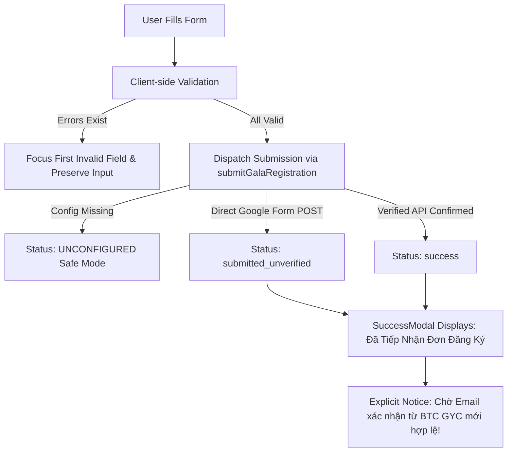

# FORM FIELD MAPPING & INTEGRATION AUDIT

**Document Reference**: `docs/revision/form-field-mapping.md`  
**Phase**: Phase 07 — Ticket Registration Form & Validation  
**Event**: Solfera – D-DAY 2026 (Gala Night)  
**Governing Document**: Customer PDF Page 8 (`[GYC][D-DAY26][SỬA WEB VÉ].pdf`)  
**Status**: Form UI & Notice **DONE** | Live Field Synchronization **BLOCKED (Missing Google Form URL)**

---

## 1. Executive Summary

Customer PDF Page 8 includes the instruction:
> *"Còn phần nội dung đăng ký vé anh sửa giúp em theo form là oki ạ, thêm cái lưu ý ở đầu form ạ"*

Per **Critical Rule 1 & 2** of the implementation roadmap:
1. **No Invention Rule**: The engineering team must **never invent** form questions, answer choices, or field entry IDs without an authorized reference.
2. **Safe Mode Enforcement**: Since no Google Form URL or questionnaire structure was attached in the PDF or repository, the existing 8-field registration schema is preserved as the functional baseline, and live field synchronization is formally classified as **`BLOCKED`**.
3. **Preamble & Notice Implementation**: The official form introduction text and two-bullet registration notice have been fully implemented at the top of the form area on [RegisterPage.jsx](file:///d:/Vibe%20Code/Web-Google-form/src/pages/RegisterPage.jsx) and within [RegistrationForm.jsx](file:///d:/Vibe%20Code/Web-Google-form/src/components/registration/RegistrationForm.jsx).

---

## 2. Field-by-Field Mapping Matrix

| # | Current Field Name | Input Type | Required? | Current Placeholder / Options | Official Form Field (Customer PDF Page 8) | Change Applied in Phase 7 | Validation Rule | Backend Dependency / Entry ID | Status |
|---|---|---|---|---|---|---|---|---|---|
| **0** | **Form Introduction** | Text Display | Mandatory Display | *N/A (Previously generic intro)* | `"Bạn vui lòng điền đầy đủ các thông tin dưới đây để đăng ký vé Standard tham dự Vòng Chung kết cuộc thi King & Queen 2026 - Gala Night D-DAY 2026: \"SOLFERA\"."` | **UPDATED**: Inserted verbatim in page subtitle and Section 1 description. | Display only | None | **DONE** |
| **0.1** | **Notice Banner** | Alert Region | Mandatory Display | *N/A (Previously 3-step E-ticket process)* | `Lưu ý:` 1. `Mỗi lượt đăng ký sẽ tương ứng với 01 vé.` 2. `Vì số lượng khán giả được giới hạn nên những đơn đăng ký có Email xác nhận từ Ban Tổ chức GYC - Câu lạc bộ thế hệ trẻ AEP mới được coi là đơn đăng ký hợp lệ.` | **ADDED**: Prominent gold/wine notice banner rendered at the top of form card. | Display only | None | **DONE** |
| **1** | `fullName` | `text` | **Yes** | `"Ví dụ: Nguyễn Văn An"` | *Pending Google Form URL* | Preserved baseline. Type: String (2-100 chars). | Vietnamese Unicode name regex (`NAME_VN`), min 2, max 100 chars. | `entries.fullName` (`[PLACEHOLDER_ENTRY_FULL_NAME]`) | **BLOCKED (Awaiting Form)** |
| **2** | `email` | `email` | **Yes** | `"example@gmail.com"` | *Pending Google Form URL* | Preserved baseline. Type: Email (max 150 chars). | RFC 5322 regex (`EMAIL`), max 150 chars. | `entries.email` (`[PLACEHOLDER_ENTRY_EMAIL]`) | **BLOCKED (Awaiting Form)** |
| **3** | `phone` | `tel` | **Yes** | `"0987654321"` | *Pending Google Form URL* | Preserved baseline. Normalizes spaces, dashes, dots. | Vietnamese phone regex (`PHONE_VN`: 10 digits starting with 03, 05, 07, 08, 09, or +84). | `entries.phone` (`[PLACEHOLDER_ENTRY_PHONE]`) | **BLOCKED (Awaiting Form)** |
| **4** | `studentId` | `text` | **No** (Optional) | `"Ví dụ: 11234567"` | *Pending Google Form URL* | **UPDATED**: Replaced PTIT placeholder (`B23DCCN001`) with NEU standard 8-digit format (`11234567`). | Optional; if entered: 4-20 chars. | `entries.studentId` (`[PLACEHOLDER_ENTRY_STUDENT_ID]`) | **BLOCKED (Awaiting Form)** |
| **5** | `className` | `text` | **No** (Optional) | `"Ví dụ: POHE 68A hoặc Viện ĐTTT, CLC & POHE"` | *Pending Google Form URL* | **UPDATED**: Replaced PTIT placeholder (`D23CQCN01-B`) with POHE/AEP format. | Optional; if entered: max 100 chars. | `entries.className` (`[PLACEHOLDER_ENTRY_CLASS_NAME]`) | **BLOCKED (Awaiting Form)** |
| **6** | `attendeeType` | `radio` | **Yes** | Options: `Thành viên CLB`, `Cựu thành viên`, `Khách mời`, `Khác` | *Pending Google Form URL* | Preserved baseline. Radio group single choice. | Must match one of 4 predefined values. | `entries.attendeeType` (`[PLACEHOLDER_ENTRY_ATTENDEE_TYPE]`) | **BLOCKED (Awaiting Form)** |
| **7** | `note` | `textarea` | **No** (Optional) | `"Lời nhắn gửi, yêu cầu chỗ ngồi hoặc câu hỏi dành cho Ban Tổ Chức..."` | *Pending Google Form URL* | Preserved baseline. 4 rows, max 1000 chars. | Optional; max 1000 chars. | `entries.note` (`[PLACEHOLDER_ENTRY_NOTE]`) | **BLOCKED (Awaiting Form)** |
| **8** | `consent` | `checkbox` | **Yes** | `"Tôi đồng ý cho phép Ban Tổ Chức sử dụng thông tin trên cho mục đích tổ chức sự kiện Gala Night D-DAY 2026: “SOLFERA”."` | *Pending Google Form URL* | **UPDATED**: Aligned event name from generic `GALA NIGHT 2026` to `Gala Night D-DAY 2026: “SOLFERA”`. | Must be checked (`true`). | `entries.consent` (`[PLACEHOLDER_ENTRY_CONSENT]`) | **BLOCKED (Awaiting Form)** |

---

## 3. Submission Lifecyle & Status Integrity Mapping

Per Phase 7 core principles, the frontend strictly distinguishes three separate states:
1. **Validation Passed**: User inputs satisfy client-side constraints.
2. **Submission Dispatched / Accepted**: Network payload was sent to Google Forms / backend sink.
3. **Valid Confirmed Ticket**: **Only** achieved when the applicant receives an official confirmation email from GYC (`dday26.gyc@gmail.com`).

---

## 4. Remaining Blocker & Action Items for Customer

To unblock **`REQ-16`** and enable direct synchronization with the organizer's Google Form:
1. **Provide Google Form URL**: Share the live or edit link of the official Google Form (e.g. `https://docs.google.com/forms/d/e/.../viewform`).
2. **Authorize Form Schema**: Confirm whether the official Google Form includes questions beyond the 8 baseline fields (e.g., student ID verification, photo upload, specific King & Queen voting questions).
3. **Map Entry IDs**: Extract the Google Form `entry.XXXXXXXXX` IDs and paste them into [src/services/googleForm.js](file:///d:/Vibe%20Code/Web-Google-form/src/services/googleForm.js#L56-L65).
